# 基于多传感器融合的数据显示平台

> 本科毕业设计 · 面向无人机高度测量的数据采集、滤波可视化与智能调参一体化平台

[](https://www.qt.io/)
[](https://isocpp.org/)
[](https://dotnet.microsoft.com/)
[](https://www.arduino.cc/)
[](https://www.st.com/)

**一句话概括**：用 Arduino + 超声波/激光双传感器采集无人机高度数据，经自定义串口协议上传上位机，在 Qt6 平台上并行运行三种滤波算法、实时对比波形，并通过 DeepSeek API 自动推荐最优滤波参数。

👉 **[作品集首页（应聘用）](https://yichen666332.github.io/1/)** ｜ **[项目技术详情](https://yichen666332.github.io/1/project.html)** ｜ **[论文摘要与技术节选](docs/THESIS_SUMMARY.md)** ｜ **[系统架构说明](docs/ARCHITECTURE.md)**

---

## 作品集导航（应聘用）

仓库里有两份页面，共用同一套图片与实测数据，分别面向不同读者：

| 页面 | 给谁看 | 内容 |
| --- | --- | --- |
| `index.html` · [作品集首页](https://yichen666332.github.io/1/) | 招聘方 / HR | 个人定位与求职意向、基本信息、专业能力矩阵、核心项目 STAR 叙事、量化成果表、精选图集、教育背景与联系方式；内置「保存为 PDF」打印样式，可直接导出投递 |
| `project.html` · [项目技术详情](https://yichen666332.github.io/1/project.html) | 技术面试官 | 完整技术实现：问题背景、三层架构、三路滤波与组合策略、实测数据、AI 调参对照、全量界面 / 波形 / 实物图集、技术栈 |
| `README.md` | 工程师 | 工程文档：架构、模块、实测数据、目录结构、本地运行方式 |

### 首次使用：补充 4 项个人信息

打开 `index.html`，找到 `<script>` 开头的 `PROFILE` 配置，填入 4 个值，页面所有出现位置会自动同步：

```js
var PROFILE={
  school:'',   // 学校 · 专业，例如：XX大学 · 自动化
  city:'',     // 所在城市，例如：成都
  email:'',    // 邮箱，例如：name@example.com
  phone:''     // 手机 / 微信，例如：138-0000-0000
};
```

未填写时页面顶部会出现橙色提示条、待补位置以橙色虚线标出；4 项都填好后提示条自动消失，打印 / 导出 PDF 时也不会出现。

**还需按实际情况确认两处**：Hero 的「应聘方向」（当前写的是嵌入式软件 / 上位机开发），以及基本信息卡里的「求职状态」（当前为「2026 届 · 求职中」）。若目标岗位不同，建议同步调整能力分组顺序与项目 STAR 的侧重。

> 页面中所有量化指标均取自毕业论文第 4 章实测，未做夸大。教育背景仅写「本科 · 2026 届」与毕业设计成果，未填学校、课程等未经核实的信息。

---

## 目录

- [作品集导航（应聘用）](#作品集导航应聘用)
- [项目背景](#项目背景)
- [核心指标](#核心指标)
- [系统架构](#系统架构)
- [技术栈](#技术栈)
- [核心实现](#核心实现)
- [实测结果](#实测结果)
- [仓库结构](#仓库结构)
- [本地运行](#本地运行)
- [论文信息](#论文信息)

---

## 项目背景

无人机高度测量中，单一传感器极易受环境干扰：超声波在软质表面、温度变化下会产生跳变，激光测距在强光与低反射率场景下会出现野值，原始数据抖动严重，直接影响飞控稳定性。

本课题设计并实现了一套**上下位机协同**的多传感器数据显示平台：

- **下位机**：Arduino Uno R3 驱动 HC-SR04 超声波模块与 TOF050F 激光测距模块，完成采集与初步处理，经 USB-TTL / 数传模块上传；
- **上位机**：Qt6 桌面应用，负责串口帧解析、三路滤波并行计算、实时波形绘制、算法评分与参数自动整定；
- **目标**：为多传感器融合算法研究提供一个**高实时性、强可视化、具备自适应能力**的完整验证环境。

---

## 核心指标

| 指标 | 结果 | 说明 |
| --- | --- | --- |
| 数据吞吐 | **≥ 50 帧/秒** | 多源传感器数据实时接收与处理 |
| 通信可靠性 | **丢包率 ≈ 5%** | 115200 波特率下连续运行 8 小时实测 |
| 自适应卡尔曼滤波 | **8.55 cm → 7.44 cm（↓12.97%）** | 滤波前后数据标准差 |
| 自适应中值滤波 | **脉冲滤除率 99%~100%** | 最大脉冲幅度 33.47 cm → 4.28 cm（↓87.22%） |
| H∞ 鲁棒滤波 | **最大估计误差 8.2 cm** | 模型失配强干扰环境下仍保持有界 |
| 卡尔曼 + 中值组合 | **91.5% / 89.4%** | 高斯噪声抑制率 / 脉冲滤除率 |
| 卡尔曼 + H∞ 组合 | **13.6 cm → 11.8 cm** | 强干扰下最坏情况误差 |
| DeepSeek 智能调参 | **评分 < 70 → ≈ 80** | 有无 AI 调参的对照实验结论 |

> 以上数据均来自毕业论文第 4 章「硬件环境搭建与测试」的实测与仿真结果，详见 [实测结果](#实测结果)。

---

## 系统架构

平台采用经典的**上下位机协同**模式，自下而上划分为三个逻辑层次：

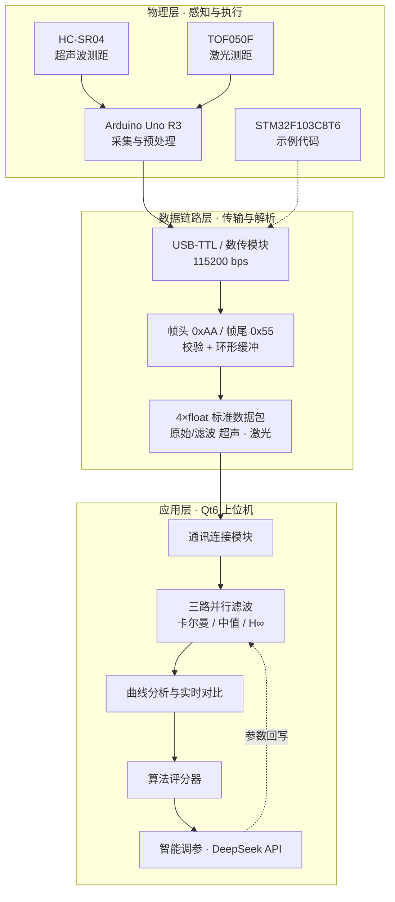

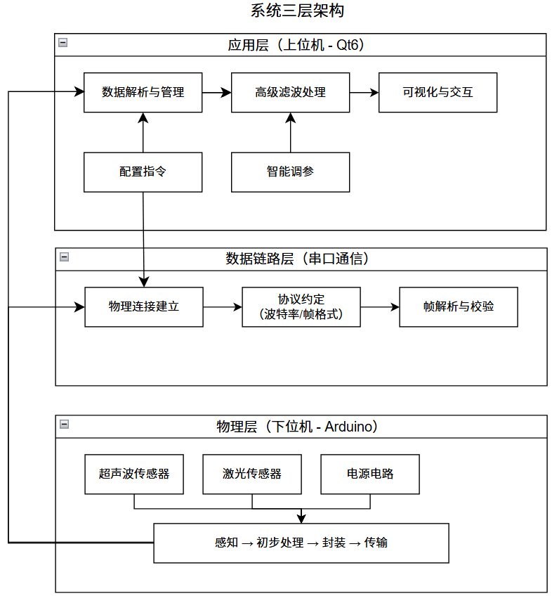

<details>
<summary>展开查看数据流与模块流程图</summary>

| 流程 | 图 |
| --- | --- |
| 数据采集与预处理 | 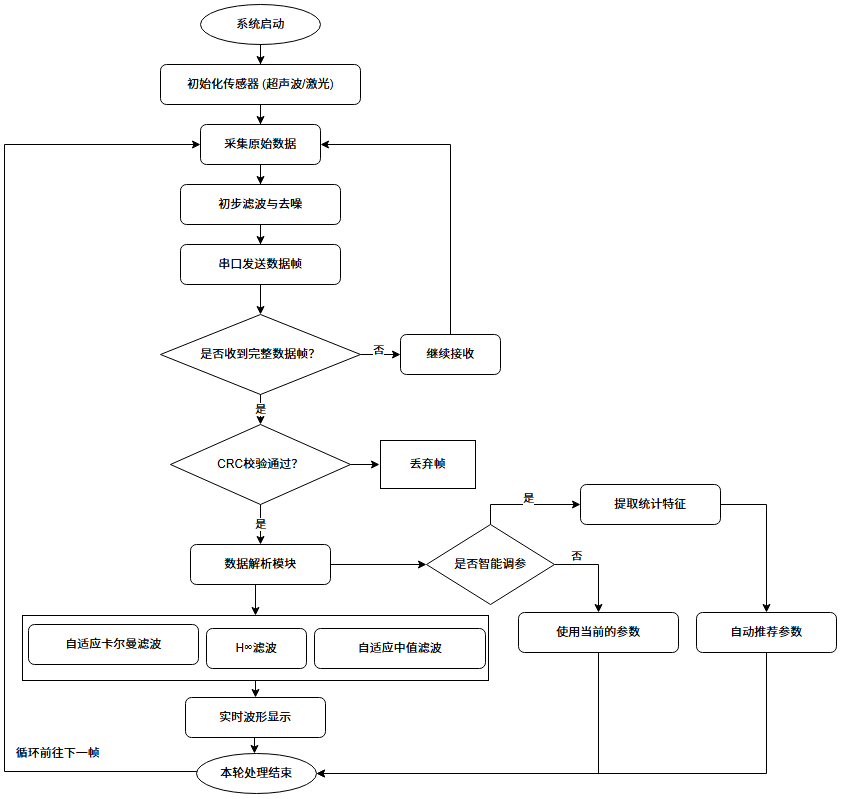 |
| 三路滤波并行处理 | 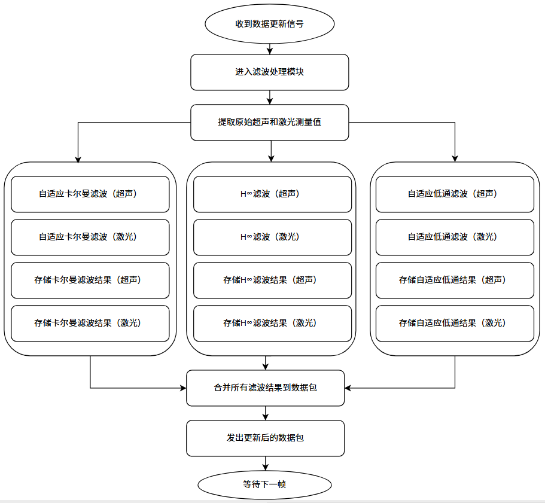 |
| 智能调参闭环 | 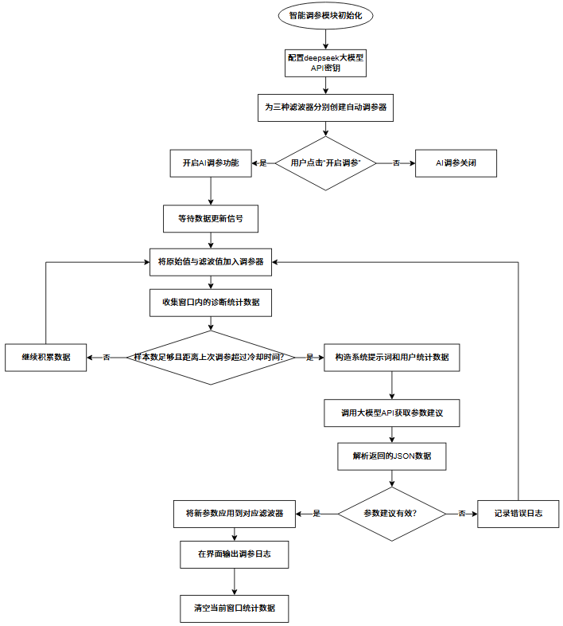 |

原始 drawio 源文件见 [`docs/diagrams/`](docs/diagrams/)。

</details>

---

## 技术栈

| 层次 | 技术 |
| --- | --- |
| 上位机（论文交付版） | Qt 6.5+ / Qt Creator 10+ / C++17 / qmake / MinGW 11.2 / Windows 11 |
| 上位机（工程化迭代版） | C# .NET 8 WinForms / SunnyUI 3.8.1 / OxyPlot.WindowsForms 2.2.0 / System.IO.Ports 9.0.8 |
| 下位机 | Arduino Uno R3 / Arduino IDE 2.3.8 / Arduino C++；STM32F103C8T6（Keil 示例工程） |
| 传感器 | HC-SR04 超声波模块、TOF050F 激光测距模块 |
| 通信 | 串口 115200 bps、自定义二进制帧、USB-TTL、数传模块、VSPD 虚拟串口 |
| 算法 | 自适应卡尔曼滤波、自适应中值滤波、H∞ 鲁棒滤波、One-Euro、切换式组合滤波 |
| AI 能力 | DeepSeek API（OpenAI 兼容接口），用于滤波参数自动整定 |
| 仿真验证 | MATLAB（算法仿真、串口数据仿真） |

> **关于两个上位机版本**：`src/qt6-host/` 是毕业论文对应的 Qt6 交付版本；`src/winforms-edition/` 是同期做的 C# / .NET 8 工程化迭代版本，补齐了自动调参器与评分器的完整实现。两者算法思路一致，可对照阅读。

---

## 核心实现

### 1. 可靠串口通信协议

```
[ 0xAA ][ 长度 / 类型 ][ 4 × float：原始超声 | 滤波超声 | 原始激光 | 滤波激光 ][ 校验 ][ 0x55 ]
```

- 帧头 `0xAA` / 帧尾 `0x55` 定位，配合校验字段解决**粘包、丢包、误码**；
- 每次读取 8 KB 追加到**环形缓冲区**，循环扫描帧头，校验失败则消耗当前字节继续扫描；
- 同时兼容 Arduino `Serial.print` 的**文本行协议**，用正则提取数值并统一转成标准数据包；
- 全链路非阻塞异步，界面不卡顿；`SlidingRateCounter` 实时统计字节速率与帧率（Hz）。

关键代码：[`serialframeparser.cpp`](src/qt6-host/core/serialframeparser.cpp) · [`winserialreader.cpp`](src/qt6-host/core/winserialreader.cpp) · [`serialdataengine.cpp`](src/qt6-host/core/serialdataengine.cpp)

### 2. 三路并行滤波算法

数据包到达后，原始超声值与激光值被**同时**送入三条独立滤波链路，便于在同一坐标系下横向对比：

| 算法 | 擅长场景 | 实测表现 |
| --- | --- | --- |
| 自适应卡尔曼滤波 `AdaptiveKalmanFilter` | 高斯噪声 | 标准差降低 12.97%，R 参数在线自适应 |
| 自适应中值滤波 `medianfilter` | 脉冲噪声 / 野值 | 脉冲滤除率 99% |
| H∞ 鲁棒滤波 `RobustHInfinityFilter` | 模型失配、强干扰 | 干扰区间保持有界估计，不发散 |

关键代码：[`core/filters/`](src/qt6-host/core/filters/) · [`滤波算法/`](src/winforms-edition/滤波算法/)

### 3. 组合滤波策略

- **串行组合**：中值 → 卡尔曼（去野值后再平滑）、中值 → H∞；
- **切换式并联组合**：卡尔曼 + H∞，平稳段用卡尔曼保精度，突变段切到 H∞ 保鲁棒；
- 推荐配置：常规环境用「自适应卡尔曼 + 自适应中值」，强不确定性环境切到「卡尔曼 + H∞」。

关键代码：[`combinedfilterwidget.cpp`](src/qt6-host/modules/curveanalysis/combined/combinedfilterwidget.cpp)

### 4. 智能调参闭环（DeepSeek API）

评分器在滑动窗口内对滤波输出打分 → 提取数据特征 → 组装提示词调用 DeepSeek → 解析严格 JSON 格式的参数建议 → 回写 Q / Alpha / 滤波器选择，形成**「采集 → 评分 → 调参 → 复评」**闭环。

对照实验表明：无 AI 调参时评分基本在 70 以下，开启后稳定到 80 左右。

> ⚠️ **密钥安全**：仓库里所有填写 API Key 的位置都已写成占位符 **`更换你的密钥`**（见 `src/qt6-host/modules/smarttuning/smarttuningwidget.cpp` 和 `src/winforms-edition/App.config`）。本地运行时把它替换成自己的 Key 即可，建议通过环境变量或本地配置文件注入，**切勿硬编码提交**。

关键代码：[`deepseekclient_qt.cpp`](src/qt6-host/modules/smarttuning/deepseekclient_qt.cpp) · [`akf_autotuner_qt.cpp`](src/qt6-host/modules/smarttuning/akf/akf_autotuner_qt.cpp) · [`智能调参器/`](src/winforms-edition/智能调参器/)

### 5. 上位机界面

Qt6 纯代码搭建（不使用 `.ui` 文件），左侧导航 + 右侧堆叠页面，四个功能页：

| 页面 | 功能 |
| --- | --- |
| 通讯连接 | 串口号 / 波特率配置、连接状态、字节速率与帧率统计 |
| 滤波数据 | 三路滤波输出数值实时对照 |
| 曲线分析 | 原始 / 滤波波形叠加、组合策略切换、评分窗口 |
| 智能调参 | DeepSeek 连通性自检、参数推荐与一键应用 |

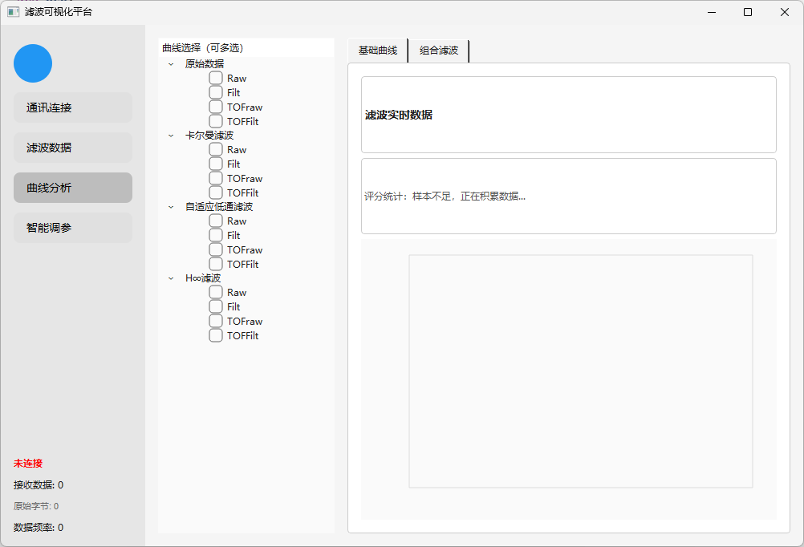

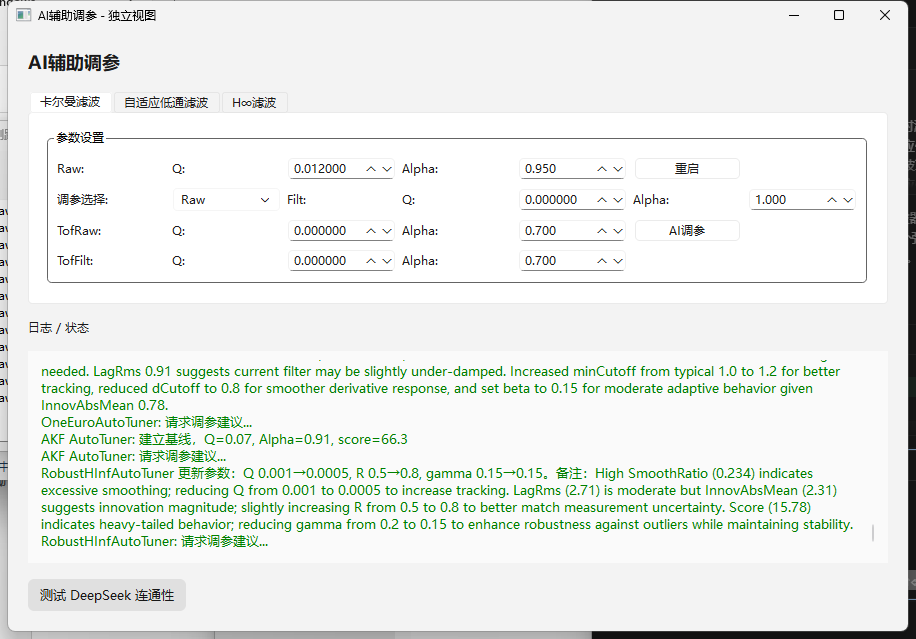

更多界面与波形截图见 [`assets/`](assets/) 与[项目技术详情页](https://yichen666332.github.io/1/project.html)。

---

## 实测结果

### 通信稳定性

设置下位机以 50 Hz 固定频率持续发送数据帧，上位机连续接收 **8 小时**，统计接收帧数、校验错误帧数与丢包率。结果表明在 115200 波特率下丢包率约 **5%**，CRC / 校验错误率控制在低水平，满足实时性要求。

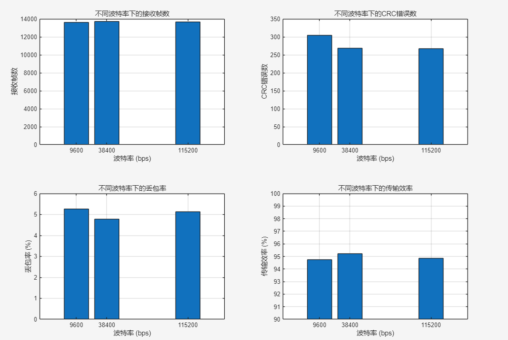

### 单算法与组合算法对比

| 测试 | 结论 |
| --- | --- |
| 自适应卡尔曼 | 有效抑制高斯噪声，标准差由 8.55 cm 降至 7.44 cm（↓12.97%） |
| 自适应中值 | 识别并消除脉冲噪声，滤除率 99%~100%，最大脉冲幅度由 33.47 cm 降至 4.28 cm（↓87.22%），同时保持信号边缘 |
| H∞ | 干扰区间保持有界估计，最大估计误差控制在 8.2 cm，未出现发散，鲁棒性最强 |
| 中值 → 卡尔曼 | 高斯噪声抑制率 91.5%、脉冲滤除率 89.4%，输出平滑无异常跳变 |
| 卡尔曼 ↔ H∞ 切换 | 最坏情况误差由 13.6 cm 降至 11.8 cm |
| 中值 → H∞ | 脉冲噪声与高频抖动同时被抑制 |

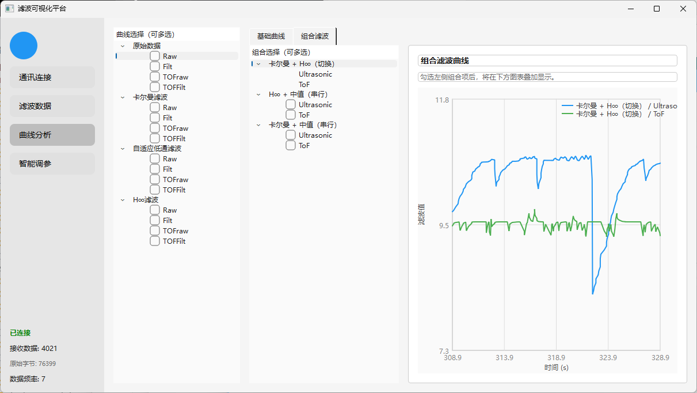

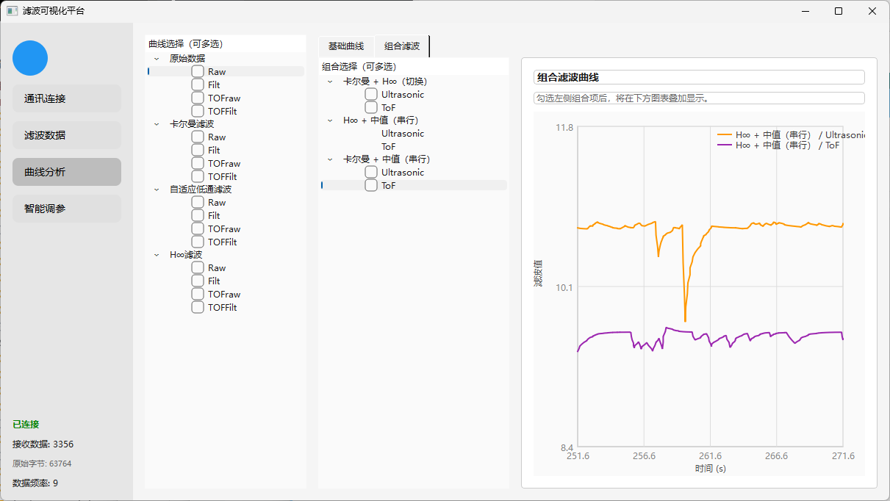

### 智能调参对照实验

| 组别 | 评分表现 |
| --- | --- |
| 无 AI 调参 | 基本在 70 以下 |
| 有 AI 调参 | 提升到 80 左右 |

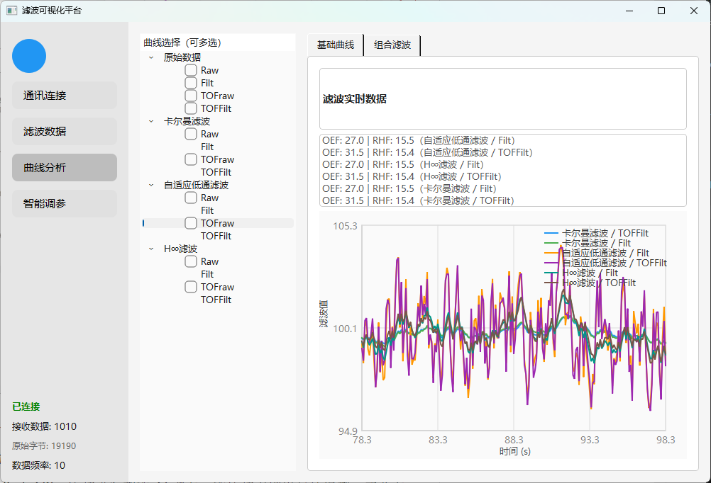　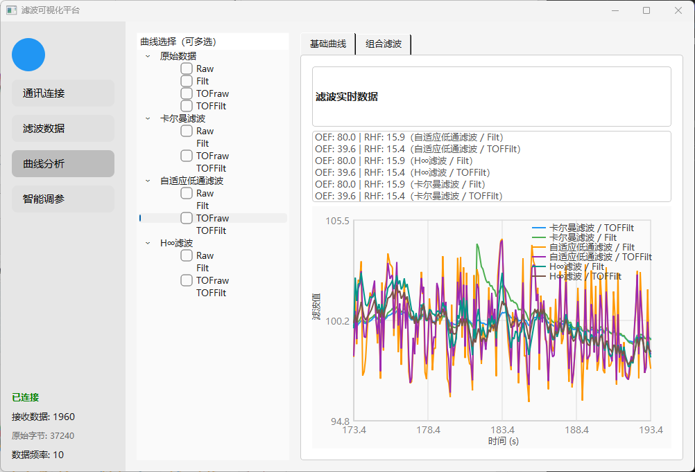

---

## 仓库结构

```
.
├── index.html                    # 作品集首页（应聘用，GitHub Pages 入口）
├── project.html                  # 项目技术详情页（完整架构 / 算法 / 图集）
├── README.md                     # 本文件
├── assets/                       # 界面截图、波形图、架构图、实物照片
├── docs/
│   ├── THESIS_SUMMARY.md         # 论文摘要与关键技术节选
│   ├── ARCHITECTURE.md           # 系统架构与模块设计说明
│   └── diagrams/                 # 4 份 drawio 原始流程图
└── src/
    ├── qt6-host/                 # Qt6 上位机完整工程（论文交付版）
    │   ├── FilterVisualizationPlatform.pro
    │   ├── main.cpp / mainwindow.*
    │   ├── core/                 # 串口引擎、帧解析、仿真、6 种滤波器
    │   ├── modules/              # 连接 / 滤波数据 / 曲线分析 / 智能调参
    │   └── 新建与运行步骤.md
    ├── winforms-edition/         # C# .NET 8 工程化迭代版（含自动调参器、评分器）
    └── firmware/
        ├── arduino/              # Arduino 采集与数传固件
        └── stm32/                # STM32F103C8T6 示例工程
```

---

## 本地运行

### Qt6 上位机（推荐）

```bash
# 1. 用 Qt Creator 打开工程
#    文件 → 打开文件或项目 → src/qt6-host/FilterVisualizationPlatform.pro
# 2. 选择 Desktop Qt 6.x MinGW 64-bit 套件，Ctrl+B 构建，Ctrl+R 运行
```

- 依赖：Qt 6.5+（widgets / core / gui / network），C++17 编译器；
- 无硬件时可用 VSPD 等虚拟串口软件做 COM1 → COM2 转发，程序默认从 COM2 接收；
- 也可用内置 `core/simulationengine.*` 生成仿真数据，无需下位机即可查看波形与滤波效果；
- 详细步骤见 [`src/qt6-host/新建与运行步骤.md`](src/qt6-host/新建与运行步骤.md)。

### 下位机

- Arduino：用 Arduino IDE 2.3.8 打开 `src/firmware/arduino/*.ino`，选择 Uno R3 与对应端口上传；接线参考 `assets/hardware-wiring-arduino.jpg`；
- STM32：Keil 打开 `src/firmware/stm32/demo.uvprojx`。

### C# 迭代版

```bash
cd src/winforms-edition
dotnet build FilterVisualPlatform.csproj
dotnet run
```

> 智能调参功能需要配置有效的 DeepSeek API Key；未配置时其余模块不受影响。

---

## 论文信息

| 项目 | 内容 |
| --- | --- |
| 题目 | 基于多传感器融合的数据显示平台设计 |
| 作者 | 易成龙 |
| 类型 | 本科毕业论文（设计） |
| 关键词 | 多传感器融合；Qt6；滤波算法；数据显示 |
| 章节 | 绪论 / 相关技术与理论基础 / 平台设计 / 硬件环境搭建与测试 / 总结与展望 |

论文**原文不公开**，仓库仅收录[摘要与关键技术节选](docs/THESIS_SUMMARY.md)，用于说明项目背景与技术依据。

---

## 说明

- 本仓库为毕业设计的**作品集节选**：已剔除 Qt 安装包、驱动程序、编译产物（`build/` `bin/` `obj/` `output/`）与第三方 DLL，仅保留自研源码、文档与图表。
- 所有实测数据均引自毕业论文，未做二次加工；图片来自论文插图与实物拍摄。
- 如需引用或转载，请注明出处。

---

© 2026 易成龙 · Built with Qt6 / C++17 / .NET 8
