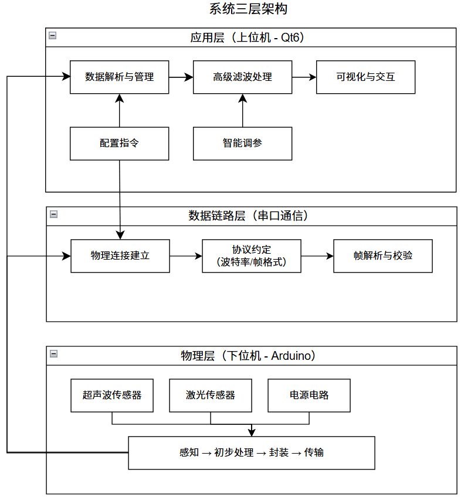
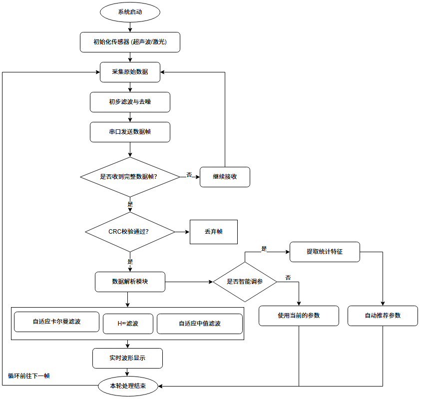
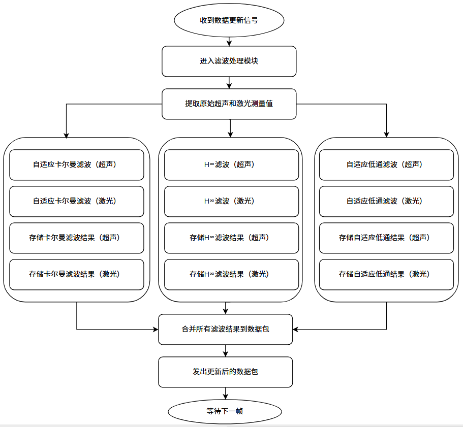
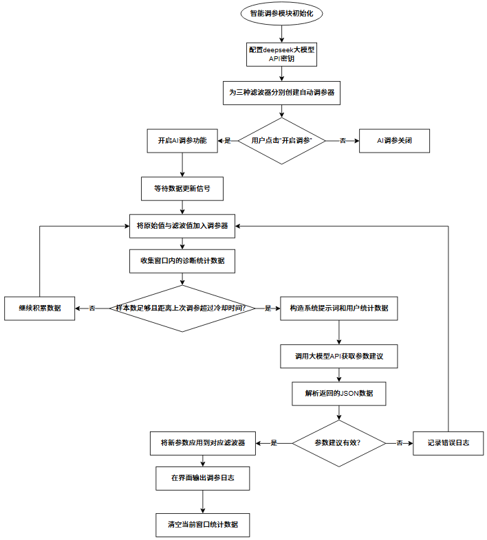

# 系统架构与模块设计

> 本文对应毕业论文第 3 章「多传感器数据显示平台设计」，说明上下位机协同架构、通信协议与软件模块划分。

---

## 1. 总体架构

平台采用经典的**上下位机协同**工作模式，自下而上划分为三个逻辑层次，各层职责清晰、功能解耦。

| 层次 | 组成 | 职责 |
| --- | --- | --- |
| **物理层** | Arduino Uno R3、HC-SR04 超声波模块、TOF050F 激光测距模块、USB-TTL / 数传模块 | 高度数据采集、初步滤波、电气连接 |
| **数据链路层** | 自定义串口帧协议、环形缓冲区、帧解析器、速率统计器 | 数据封装、帧同步、校验、粘包/丢包处理、异步投递 |
| **应用层** | Qt6 上位机四个功能页 + 算法层 + 评分器 + 智能调参器 | 实时可视化、滤波计算、算法对比、参数自动整定 |



### 开发环境

| 项 | 配置 |
| --- | --- |
| 上位机 OS | Windows 11 |
| IDE / 框架 | Qt Creator 10.0+ / Qt 6.5+ / MinGW 11.2 / C++17 |
| 下位机 IDE | Arduino IDE 2.3.8 / Arduino C++ |
| 仿真工具 | MATLAB（算法仿真、串口数据仿真） |

---

## 2. 通信协议设计

```
┌────────┬──────────────┬───────────────────────────────────────────┬────────┬────────┐
│ 0xAA   │ 长度 / 类型   │ 4 × float                                  │ 校验   │ 0x55   │
│ 帧头   │              │ 原始超声 │ 滤波超声 │ 原始激光 │ 滤波激光   │        │ 帧尾   │
└────────┴──────────────┴───────────────────────────────────────────┴────────┴────────┘
```

- **帧同步**：帧头 `0xAA` / 帧尾 `0x55` 定位，配合校验字段识别误码；
- **缓冲机制**：每次读取 8 KB 追加到环形缓冲区，循环扫描帧头；若帧头命中但帧尾或校验不通过，则消耗当前字节继续扫描，避免粘包导致整条流失效；
- **兼容模式**：同时支持 Arduino `Serial.print` 输出的文本行协议，用正则提取数值并转成统一的标准数据包；
- **非阻塞**：串口读取与解析置于独立线程 / 异步通道，通过 Qt 信号槽投递给界面，保证 UI 不卡顿；
- **可观测**：`SlidingRateCounter` 在 1 秒滑动窗口内统计字节速率与帧率（Hz），实时显示在状态栏。



实测：115200 波特率、50 Hz 固定帧率下连续运行 8 小时，丢包率约 5%。

---

## 3. 软件模块划分

Qt6 上位机采用「左侧导航 + 右侧 `QStackedWidget`」的纯代码界面（不使用 `.ui` 文件），共四个功能页：

| 模块 | 目录 | 功能 |
| --- | --- | --- |
| 通讯连接 | `modules/connection/` | 串口号 / 波特率配置、连接状态、速率与帧率统计 |
| 滤波数据 | `modules/filterdata/` | 三路滤波输出数值实时对照 |
| 曲线分析 | `modules/curveanalysis/` | 原始 / 滤波波形叠加、组合策略切换、评分窗口 |
| 智能调参 | `modules/smarttuning/` | DeepSeek 连通性自检、参数推荐、一键应用与复评 |

底层支撑层 `core/`：

| 文件 | 作用 |
| --- | --- |
| `core/filterdatapacket.h` | 标准数据包结构定义 |
| `core/winserialreader.*` | Windows 串口异步读取 |
| `core/serialframeparser.*` | 帧解析与校验 |
| `core/serialdataengine.*` | 数据引擎，向上层统一投递数据包 |
| `core/simulationengine.*` | 无硬件时的仿真数据源 |
| `core/filters/*` | 6 个滤波器实现（卡尔曼 / 中值 / H∞ / 自适应卡尔曼 / One-Euro / 鲁棒 H∞） |



---

## 4. 三路并行滤波链路

标准数据包到达后，原始超声值与激光值被**同时**送入三条独立链路，输出在同一坐标系下叠加对比：

```
                    ┌─→ 自适应卡尔曼滤波 ─┐
原始数据 (超声/激光) ┼─→ 自适应中值滤波 ──┼─→ 波形叠加 / 评分 / 参数回写
                    └─→ H∞ 鲁棒滤波 ────┘
```

| 算法 | 抑制目标 | 特点 |
| --- | --- | --- |
| 自适应卡尔曼 | 高斯噪声 | 测量噪声 R 在线自适应，Q / Alpha 可人工锁定 |
| 自适应中值 | 脉冲噪声 / 野值 | 窗口内识别尖峰并替换，保留信号边缘 |
| H∞ 鲁棒 | 模型失配、强干扰 | 不依赖噪声统计特性，保证估计误差有界 |

### 组合策略

- **串行**：中值 → 卡尔曼（先去野值再平滑）、中值 → H∞；
- **切换式并联**：卡尔曼 ↔ H∞，平稳段用卡尔曼保精度，突变段切到 H∞ 保鲁棒；
- **推荐配置**：常规环境用「卡尔曼 + 中值」；强不确定性环境切到「卡尔曼 + H∞」。

实现见 `modules/curveanalysis/combined/combinedfilterwidget.cpp`。

---

## 5. 智能调参闭环

```
采集数据 → 滑动窗口评分器 → 特征提取 → 组装 Prompt
    ↑                                      ↓
    └──── 参数回写 (Q / Alpha / 滤波器) ← DeepSeek API → 严格 JSON 建议
```

- 评分器（`evalwindow_qt.h` / `oefscorer_qt.h` / `rhfscorer_qt.h`）在滑动窗口内对滤波输出打分；
- 调参器（`akf_autotuner_qt.*` / `oneeuro_autotuner_qt.*` / `robusthinf_autotuner_qt.*`）负责特征组装、提示词生成与结果解析；
- `deepseekclient_qt.*` 封装 OpenAI 兼容接口，支持连通性自检（`Ping`）与严格 JSON 输出；
- 参数回写后重新评分，形成闭环。对照实验：无 AI 调参评分基本在 70 以下，开启后稳定到 80 左右。



> ⚠️ 仓库内所有 API Key 位置均为占位符 **`更换你的密钥`**，请本地替换后使用，勿提交真实密钥。

---

## 6. 两个上位机版本的关系

| 版本 | 目录 | 定位 |
| --- | --- | --- |
| Qt6 / C++17 | [`src/qt6-host/`](../src/qt6-host/) | 论文交付版，界面与算法链路完整 |
| C# / .NET 8 WinForms | [`src/winforms-edition/`](../src/winforms-edition/) | 同期工程化迭代版，补齐自动调参器、评分器与串口速率统计的完整实现 |

两者算法思路一致，可对照阅读；下位机固件见 [`src/firmware/`](../src/firmware/)。

---

## 7. 流程图源文件

| 文件 | 对应内容 |
| --- | --- |
| `diagrams/data-transmission-flow.drawio` | 数据传输流程 |
| `diagrams/filtering-algorithm-flow.drawio` | 滤波算法流程 |
| `diagrams/smart-tuning-module.drawio` | 智能调参模块 |
| `diagrams/ui-design-module.drawio` | 界面设计模块 |

用 [draw.io](https://app.diagrams.net/) 或 VS Code 的 Draw.io Integration 插件打开即可编辑。
